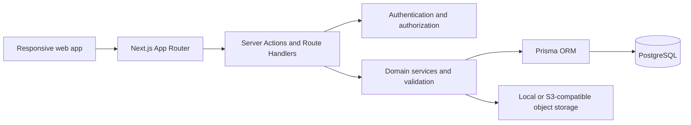
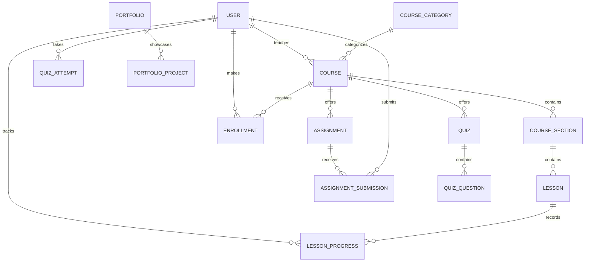

# EduTrack

**Make room for what’s next.** EduTrack is a learning platform concept for students and instructors, built around clear learning paths, measurable progress and a calmer course experience.

## Current status

The current development slice includes a responsive public landing page and course catalog, database-backed registration/login, role-aware dashboards, instructor draft course/section/lesson authoring with admin review, free enrollment with prerequisite checks, a protected lesson player with saved watch position/completion, text assignment submission/grading with notifications, published quiz attempts with automatic objective-question scoring, and admin user access/course moderation/audit views. The PostgreSQL schema, initial migration and demo seed are included. Email verification, password recovery, media/resource uploads, quiz authoring and manual short-answer grading, assignment file uploads/deadline configuration, advanced learning features and broader journey coverage remain in progress; these are not presented as complete.

## Technology

- Next.js App Router, React and strict TypeScript
- Tailwind CSS 4 (with a custom product design system)
- PostgreSQL and Prisma
- Auth.js (NextAuth credentials), bcryptjs and Zod back registration and login
- React Hook Form, Recharts, TanStack Table, Motion and Lucide are installed for upcoming screens; several are not yet used by the current routes

## Local setup

Requirements: Node.js 20.9 or newer, npm, and PostgreSQL 14 or newer.

```bash
npm install
cp .env.example .env
# Set DATABASE_URL to your local PostgreSQL database
npx prisma generate
npm run db:migrate
npm run db:seed
npm run dev
```

Open [http://localhost:3000](http://localhost:3000).

## Architecture



## Data model

The initial schema covers identity and roles, course catalogs/curricula, enrollment/progress, assignments, quizzes, certificates, achievements, learning sessions, portfolio projects, peer reviews, focus rooms, notifications, challenges and audit records.



## Authentication and demo data

The seed creates one administrator, three instructors, ten students and eight published sample courses with sections, lessons, assignments and quizzes. Set a private `DEMO_PASSWORD` in your local environment before running the seed; it will be used for the seeded accounts. Sample email addresses are `admin@edutrack.demo`, `instructor1@edutrack.demo` through `instructor3@edutrack.demo`, and `student1@edutrack.demo` through `student10@edutrack.demo`.

These accounts are strictly for local demo data. Do not use a shared or default password in a public deployment. Public registration only accepts student/instructor roles; administrator accounts are created by the seed/setup process.

## Checks

```bash
npm run lint
npm run typecheck
npm run test
npx playwright install chromium
npm run test:e2e
npm run build
```

The current unit suite covers course progress, quiz scoring, revision intervals, prerequisite checks and achievement thresholds. The Playwright smoke suite covers public discovery/signup entry points. Database-backed role journeys need a configured PostgreSQL database, applied migration and seed data.

## Deployment target

The project is intended for Vercel with a managed PostgreSQL provider such as Neon or Supabase. Media storage is designed for an S3-compatible service. Configure secrets in the deployment environment and run reviewed Prisma migrations as part of release operations.

## License

See [LICENSE](./LICENSE).
